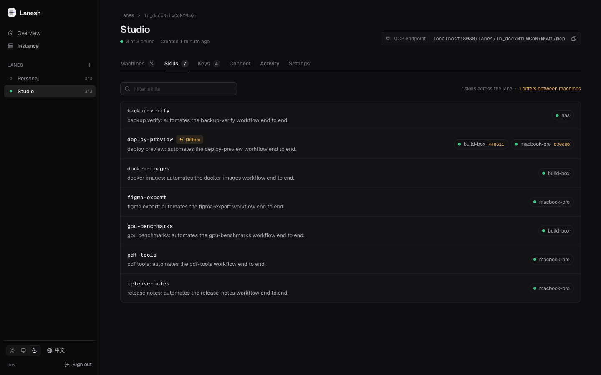
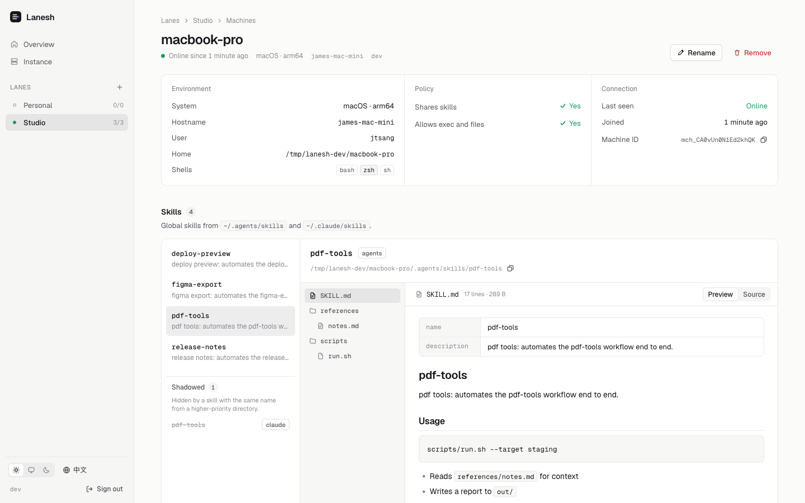

# Lanesh

**Share skills and shells across your machines through one MCP endpoint.**

[](https://github.com/jtsang4/lanesh/actions/workflows/ci.yml)
[](https://github.com/jtsang4/lanesh/releases)
[](LICENSE)

An AI agent can only use the machine it runs on. Your skills are spread across a laptop, a dev box and a GPU server, each with its own tools, credentials and network access. Copying skills around drifts out of sync, and SSH gives an agent a shell but tells it nothing about what each machine can do.

Lanesh gives an agent one MCP endpoint that reaches all of your machines. Through it, the agent can:

- **Discover** which machines are online and which global skills each one has installed
- **Read** a skill's `SKILL.md`, scripts and references on demand
- **Run** commands on a specific machine, including long-running background jobs
- **Move** files and directories between machines

A web UI shows every lane, machine and skill, manages keys, and keeps an audit log of everything agents do.



## How it works

```
Agent ──HTTP (MCP)──▶ Lanesh server ◀──WebSocket── machine A (lanesh daemon)
                      (self-hosted)  ◀──WebSocket── machine B (lanesh daemon)
```

- You self-host a **server** and create **lanes**. A lane is a group of machines that trust each other.
- Each machine runs the **lanesh daemon** as a background service and joins one or more lanes. The daemon dials out to the server, so machines behind NAT work too.
- An agent adds the lane's MCP URL and an **access key** to its MCP configuration. It does not need to install anything.

The daemon shares the global skills in `~/.agents/skills` and `~/.claude/skills`. When both contain a skill with the same name, the one in `~/.agents/skills` wins.

## Quick start

### 1. Deploy the server

With Docker Compose (or Coolify, using the same image and a persistent volume for `/data`):

```yaml
services:
  lanesh:
    image: ghcr.io/jtsang4/lanesh:latest
    restart: unless-stopped
    environment:
      LANESH_PUBLIC_URL: https://lanesh.example.com
    volumes:
      - lanesh-data:/data
    ports:
      - "8080:8080"
volumes:
  lanesh-data:
```

Put it behind a reverse proxy that terminates TLS and allows WebSocket upgrades. On first start the server prints a generated **admin token** to its log; it is shown only once. You can set `LANESH_ADMIN_TOKEN` instead.

Prefer a single binary? Download it from [Releases](https://github.com/jtsang4/lanesh/releases) and run `lanesh server --public-url https://lanesh.example.com`.

### 2. Create a lane

Open the server in a browser, sign in with the admin token, create a lane, then create a **join key** (for machines) and an **access key** (for agents). The web UI shows ready-to-paste commands for the next two steps.

From a terminal instead:

```sh
lanesh admin login https://lanesh.example.com
lanesh lane create work
lanesh key create work --kind join --name machines
lanesh key create work --kind access --name claude-code
```

### 3. Join your machines

On each machine:

```sh
# macOS / Linux
curl -fsSL https://lanesh.example.com/install.sh | sh -s -- join https://lanesh.example.com/lanes/<lane-id> --key <join-key>
```

```powershell
# Windows (PowerShell)
& ([scriptblock]::Create((irm https://lanesh.example.com/install.ps1))) join https://lanesh.example.com/lanes/<lane-id> --key <join-key>
```

Or with Node.js: `npx lanesh join https://lanesh.example.com/lanes/<lane-id> --key <join-key>`.

`lanesh join` installs the binary to `~/.lanesh/bin`, registers the machine and starts a per-user background service: a launchd agent on macOS, a systemd user unit on Linux, or a scheduled task on Windows. The daemon keeps itself on the same version as the server. Add `--no-exec` to share skills without allowing commands or file access.

### 4. Connect an agent

Claude Code:

```sh
claude mcp add --scope user --transport http lanesh https://lanesh.example.com/lanes/<lane-id>/mcp \
  --header "Authorization: Bearer <access-key>"
```

`--scope user` makes Lanesh available in every project.

Codex: add this to the global `~/.codex/config.toml`:

```toml
[mcp_servers.lanesh]
url = "https://lanesh.example.com/lanes/<lane-id>/mcp"
default_tools_approval_mode = "approve"

[mcp_servers.lanesh.http_headers]
Authorization = "Bearer <access-key>"
```

`default_tools_approval_mode = "approve"` lets Codex use Lanesh, including running commands, without asking each time; remove it to approve each call. Without it, `codex exec` rejects Lanesh commands, because nobody is there to approve them.

Cursor: add it to the global `~/.cursor/mcp.json`. The web UI shows each of these with your lane's URL filled in.

Any MCP client that supports Streamable HTTP works. Pass the access key as `Authorization: Bearer <access-key>`, or as `?key=<access-key>` if the client cannot set headers. If the agent's own machine is in the lane, add `?machine=<name>` so that Lanesh can tell the agent which machine is its own.



## MCP tools

| Tool | Purpose |
|---|---|
| `list_machines` | Machines in the lane, their status, platform, permissions and skill counts |
| `describe_machine` | A machine's environment, permissions and installed skills, plus a **briefing token** |
| `find_skills` | Optional quick keyword search over skill names and descriptions on every machine |
| `read_skill` | `SKILL.md` with the skill's file tree, a directory listing, or one or more files |
| `grep_skill` | Search a skill's text files on its machine |
| `exec` | Run a command; long commands continue as background jobs |
| `job_read` / `job_write` / `job_kill` / `job_list` | Follow, feed and stop background jobs |
| `read_file` / `write_file` | Small inline file operations |
| `transfer` | Stream a file or directory from one machine to another |
| `get_project` / `update_project` | Read or change a project: where some work lives and what an agent should know about it |

A **project** says where some work lives (a machine and a path, or several) and what an agent should know about it: free Markdown for what it is, its rules and where it stands. Locations are a guide, not a limit. Reading a project checks each location on its machine (does the path exist, which Git branch, is it a worktree, does it have `AGENTS.md` or `CLAUDE.md`), so nothing that a machine can report goes stale. Manage projects in the web UI, or tell an agent to.

Results are compact plain text kept within a token budget. Whatever Lanesh leaves out (long output, large skill trees, the rest of a file) is stated in place with how to get it, and every result ends with `[lanesh] end of result`, so an agent can tell when its client cut a result short.

Every tool that touches a machine requires that machine's briefing token, a short value such as `build-box:k3f9q2ab` returned by `describe_machine`. It makes the agent look at a machine's environment and skills before acting on it. When a call has no valid token (the agent forgot it, or the machine's skills changed), nothing runs and the reply is the machine's current briefing with its token, so the agent catches up and retries in one step. If the skills changed, the briefing starts with what changed since that agent's own last briefing (new, updated and removed skills), so a long-running session knows which skills to re-read while a new session simply sees the current state.

## Managing a machine

| Command | Description |
|---|---|
| `lanesh status` | Service state and the connection of each lane |
| `lanesh logs [-f]` | Daemon log |
| `lanesh doctor` | Diagnose the installation, service, connectivity and environment |
| `lanesh start` / `stop` / `restart` | Control the background service |
| `lanesh config set policy.allow_exec false` | Change what this machine allows (`lanesh config --help` lists all keys) |
| `lanesh update` | Update now (the daemon also follows the server's version automatically) |
| `lanesh leave <lane>` | Leave a lane; the service is removed when no lanes remain |

Commands run as your user, in your login shell's environment, so tools installed through nvm, Homebrew, pipx and similar are on the `PATH`.

## Server configuration

| Variable | Default | Description |
|---|---|---|
| `LANESH_PUBLIC_URL` | (request host) | Public URL of the server, used in install snippets |
| `LANESH_ADMIN_TOKEN` | generated | Admin token for the web UI and API |
| `LANESH_DATA_DIR` | `/data` in the image, `./data` otherwise | SQLite database location |
| `LANESH_LISTEN` | `:8080` | Listen address |
| `LANESH_TRANSFER_MAX_BYTES` | unlimited | Maximum size of one transfer |
| `LANESH_AUDIT_RETENTION_DAYS` | `90` | How long audit records are kept |
| `LANESH_LOG_LEVEL` | `info` | `debug`, `info`, `warn` or `error` |

## Security

- An access key grants control over every machine in its lane that allows execution. Treat it like an SSH key, give each agent its own, and revoke keys you no longer use.
- A lane is a trust boundary. Skills from one machine become instructions for agents, so only put machines that fully trust each other in the same lane.
- The server relays commands, output and files in plaintext and must be self-hosted behind TLS.
- Each machine decides locally what it allows (`policy.expose_skills`, `policy.allow_exec`); the server cannot override it.
- Every command, file operation and transfer is recorded in the server's audit log and in `~/.lanesh/logs/audit.log` on the machine.

See [SECURITY.md](SECURITY.md) to report a vulnerability.

## Documentation

- [Design](docs/design.md) (in Chinese): architecture, protocol, MCP tools, deployment
- [Admin API](docs/api.md)
- [Releasing](docs/releasing.md) (in Chinese)

## Development

Requirements: Go (the version in `go.mod` is fetched automatically), Node.js 24+ and pnpm (the version pinned in `web/package.json`).

```sh
make web          # build the UI (embedded into the binary)
make build        # build ./bin/lanesh
make test         # Go, web and npm launcher tests
make lint
scripts/dev.sh    # local server with demo machines at http://localhost:8080 (admin token lsa_dev_token)
make dev-web      # UI dev server with API proxy
```

See [CONTRIBUTING.md](CONTRIBUTING.md) for details.

## License

[MIT](LICENSE)
