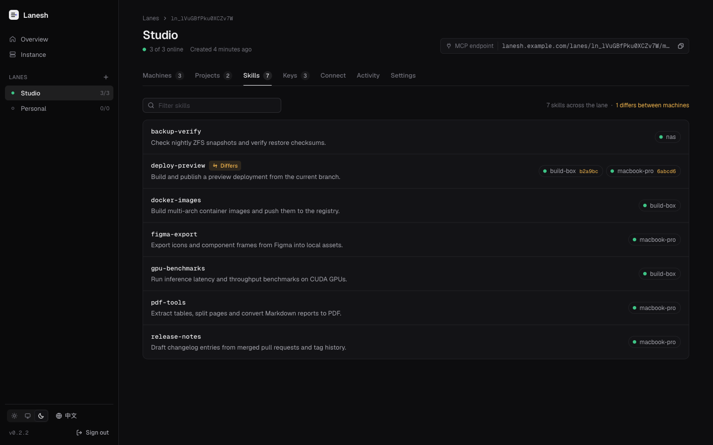
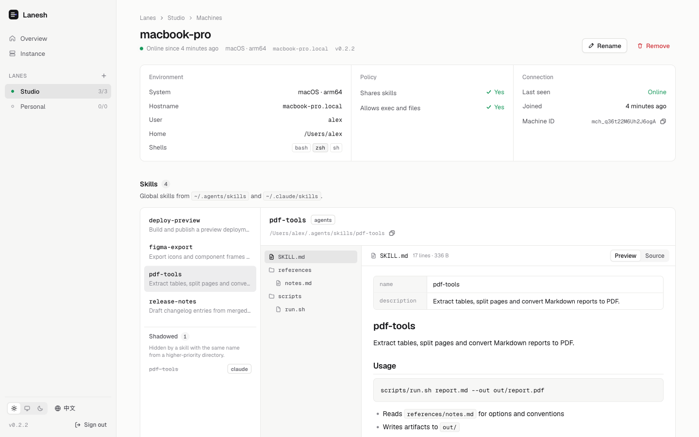
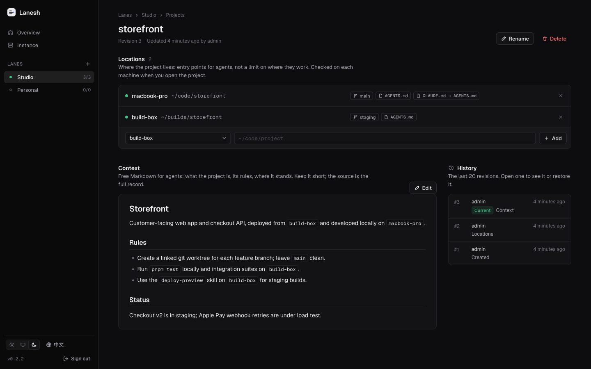

# Lanesh

**为 AI Agent 连接你的所有机器，共享 skill、shell、文件与项目。**

[](https://github.com/jtsang4/lanesh/actions/workflows/ci.yml)
[](https://github.com/jtsang4/lanesh/releases)
[](LICENSE)

[English](README.md) | **简体中文**

AI Agent 只能使用它当前所在的那台机器。你的 skill 分散在笔记本、开发机和 GPU 服务器上，每台机器各有不同的工具、凭证和网络权限。把 skill 到处复制容易版本失步；而 SSH 虽然给了 Agent 一个 shell，却无法告诉它每台机器具备什么能力。

Lanesh 为 Agent 提供一个可访问你所有机器的 MCP 端点。通过它，Agent 可以：

- **发现**哪些机器在线，以及每台机器上安装了哪些全局 skill
- **按需读取和搜索** skill 的 `SKILL.md`、脚本与参考文件
- **在指定机器上执行命令**，包括长时间运行的后台任务
- **在机器之间传输**文件和目录
- **共享项目**，提供实时位置检查（Git 分支、worktree、`AGENTS.md` / `CLAUDE.md`）与 Markdown 说明

自带的 Web 管理界面可以查看所有 Lane、机器、项目和 skill，管理凭证，并记录 Agent 所有操作的审计日志。



## 工作原理

```
Agent ──HTTP (MCP)──▶ Lanesh 服务端 ◀──WebSocket── 机器 A (lanesh daemon)
                      （自托管）    ◀──WebSocket── 机器 B (lanesh daemon)
```

- 你自行托管一个 **Lanesh 服务端**并创建 **Lane**。每个 Lane 是一组互相信任的机器。
- 每台机器以后台服务方式运行 **lanesh daemon**（守护进程）并加入一个或多个 Lane。守护进程主动向服务端发起连接，因此位于 NAT 后的机器也能加入。
- Agent 只需把 Lane 的 MCP URL 和一个 **access key** 填入 MCP 配置中，无需安装任何组件。

守护进程会共享 `~/.agents/skills` 和 `~/.claude/skills` 中的全局 skill。当两个目录中存在同名 skill 时，优先使用 `~/.agents/skills` 中的版本。

## 快速开始

### 1. 部署服务端

使用 Docker Compose 部署（也可在 Coolify 中使用同一镜像，并为 `/data` 挂载持久化卷）：

```yaml
services:
  lanesh:
    image: ghcr.io/jtsang4/lanesh:latest
    restart: unless-stopped
    environment:
      LANESH_PUBLIC_URL: https://lanesh.example.com
    volumes:
      - lanesh-data:/data
    ports:
      - "8080:8080"
volumes:
  lanesh-data:
```

把它放在反向代理后面，由反向代理终止 TLS 并放行 WebSocket 升级。首次启动时，服务端会自动生成一个**管理员令牌（admin token）**并打印到日志中（仅显示一次）；也可以通过环境变量 `LANESH_ADMIN_TOKEN` 自行指定。

如果偏好单文件二进制，可以从 [Releases](https://github.com/jtsang4/lanesh/releases) 下载并运行 `lanesh server --public-url https://lanesh.example.com`。

### 2. 创建 Lane

在浏览器中打开服务端，使用管理员令牌登录，创建一个 Lane，然后分别创建 **join key**（用于机器加入）和 **access key**（用于 Agent 接入）。Web 管理界面会给出接下来两步可直接复制执行的命令。

也可以改用终端操作：

```sh
lanesh admin login https://lanesh.example.com
lanesh lane create work
lanesh key create work --kind join --name machines
lanesh key create work --kind access --name claude-code
```

### 3. 加入机器

在每台需要加入的机器上运行：

```sh
# macOS / Linux
curl -fsSL https://lanesh.example.com/install.sh | sh -s -- join https://lanesh.example.com/lanes/<lane-id> --key <join-key>
```

```powershell
# Windows (PowerShell)
& ([scriptblock]::Create((irm https://lanesh.example.com/install.ps1))) join https://lanesh.example.com/lanes/<lane-id> --key <join-key>
```

或者通过 Node.js 运行：`npx lanesh join https://lanesh.example.com/lanes/<lane-id> --key <join-key>`。

`lanesh join` 会把二进制安装到 `~/.lanesh/bin`，注册当前机器，并启动用户级后台服务：macOS 上是 launchd agent，Linux 上是 systemd 用户服务，Windows 上是计划任务。守护进程会自动与服务端保持同一版本。加上 `--no-exec` 可只共享 skill，不开放命令执行和文件访问。

### 4. 接入 Agent

Claude Code：

```sh
claude mcp add --scope user --transport http lanesh https://lanesh.example.com/lanes/<lane-id>/mcp \
  --header "Authorization: Bearer <access-key>"
```

`--scope user` 会把 Lanesh 添加到用户级配置，所有项目都能使用。

Codex：将以下内容添加到全局的 `~/.codex/config.toml`：

```toml
[mcp_servers.lanesh]
url = "https://lanesh.example.com/lanes/<lane-id>/mcp"
default_tools_approval_mode = "approve"

[mcp_servers.lanesh.http_headers]
Authorization = "Bearer <access-key>"
```

`default_tools_approval_mode = "approve"` 让 Codex 调用 Lanesh（包括执行命令）时不再逐次确认；删掉这一行则每次调用都需要确认。如果不加这一行，`codex exec` 会因无人确认而拒绝执行 Lanesh 命令。

Cursor：添加到全局的 `~/.cursor/mcp.json`。Web 管理界面会为上述每个客户端展示已填好 Lane URL 的完整配置。

任何支持 Streamable HTTP 的 MCP 客户端都可以使用。通过 `Authorization: Bearer <access-key>` 传递 access key；如果客户端无法设置自定义请求头，可改用 `?key=<access-key>`。如果 Agent 自己所在的机器也加入了该 Lane，追加 `?machine=<name>` 可让 Lanesh 告诉 Agent 哪一台是本机。



## MCP 工具

| 工具 | 用途 |
|---|---|
| `list_machines` | 查看 Lane 中的机器及其在线状态、平台、权限和 skill 数量 |
| `describe_machine` | 查看某台机器的环境、权限、已安装的 skill，以及**简报令牌（briefing token）** |
| `find_skills` | 可选的快速路径：按关键词跨机器检索 skill 名称和描述 |
| `read_skill` | 读取 `SKILL.md` 及 skill 文件树、列出子目录，或读取一个或多个文件 |
| `grep_skill` | 在所在机器上搜索 skill 的文本文件 |
| `exec` | 执行命令；耗时较长的命令会自动转入后台任务继续运行 |
| `job_read` / `job_write` / `job_kill` / `job_list` | 读取后台任务输出、写入 stdin、终止或列出后台任务 |
| `read_file` / `write_file` | 内联读写小文件 |
| `transfer` | 在两台机器之间流式传输文件或目录 |
| `get_project` / `update_project` | 读取或更新项目：记录某项工作位于哪里，以及 Agent 需要了解什么 |

**项目（Project）**记录某项工作在哪些机器的哪些路径上（可配置多个），以及写给 Agent 的自由格式 Markdown 说明：项目是什么、有哪些规则、当前进展到哪里。位置信息只是指引，不是限制。每次读取项目时，Lanesh 都会到对应机器上实时检查各个位置（路径是否存在、当前 Git 分支、是否为 worktree、是否包含 `AGENTS.md` 或 `CLAUDE.md`），避免机器侧的状态信息过时。你可以在 Web 管理界面中管理项目，也可以直接让 Agent 帮你维护。



工具返回的结果都是精简纯文本，并控制在 token 预算以内。凡是 Lanesh 省略的内容（过长输出、庞大的 skill 文件树、文件剩余部分）都会在原处标明并给出继续读取的方式；每条结果都以 `[lanesh] end of result` 结尾，方便 Agent 判断输出是否被客户端截断。

每个操作具体机器的工具都需要携带该机器的简报令牌（由 `describe_machine` 返回的短字符串，形如 `build-box:k3f9q2ab`），用于确保 Agent 在操作之前先了解机器的环境与 skill。如果调用时缺少有效令牌（例如 Agent 忘记携带，或机器上的 skill 发生了变化），操作不会执行，而是直接返回该机器的最新简报与当前令牌，Agent 一次重试即可同步并继续。如果 skill 有变动，简报开头会列出自该 Agent 上一次获取简报以来的变更（新增、更新或移除的 skill），因此长会话能清楚知道需要重读哪些 skill，而新会话只需直接看到最新状态。

## 管理机器

| 命令 | 说明 |
|---|---|
| `lanesh status` | 查看后台服务状态及各个 Lane 的连接情况 |
| `lanesh logs [-f]` | 查看守护进程日志 |
| `lanesh doctor` | 诊断安装状态、后台服务、网络连通性与运行环境 |
| `lanesh start` / `stop` / `restart` | 控制后台服务启停与重启 |
| `lanesh config set policy.allow_exec false` | 修改本机允许的操作策略（`lanesh config --help` 可查看全部配置项） |
| `lanesh update` | 立即更新（守护进程平时也会自动跟随服务端版本升级） |
| `lanesh leave <lane>` | 退出指定 Lane；当不再属于任何 Lane 时自动移除后台服务 |

命令以你当前的用户身份、在登录 shell 的环境中执行，因此通过 nvm、Homebrew、pipx 等工具安装的程序都会出现在 `PATH` 中。

## 服务端配置

| 环境变量 | 默认值 | 说明 |
|---|---|---|
| `LANESH_PUBLIC_URL` | （请求来源地址） | 服务端的公开访问地址，用于生成安装命令和接入片段 |
| `LANESH_ADMIN_TOKEN` | 自动生成 | Web 管理界面和 API 使用的管理员令牌 |
| `LANESH_DATA_DIR` | 镜像中为 `/data`，否则为 `./data` | SQLite 数据库存放目录 |
| `LANESH_LISTEN` | `:8080` | 监听地址 |
| `LANESH_TRANSFER_MAX_BYTES` | 不限 | 单次文件传输的最大字节数 |
| `LANESH_TRANSFER_PART_BYTES` | 16 MiB | 传输上传时单个请求的最大大小；需低于前置反向代理的请求体限制（例如 Cloudflare Free/Pro 为 100 MB） |
| `LANESH_TRANSFER_GZIP` | `true` | 当两端守护进程均支持时，启用传输流压缩 |
| `LANESH_AUDIT_RETENTION_DAYS` | `90` | 审计日志保留天数（设为 `0` 表示永久保留） |
| `LANESH_LOG_LEVEL` | `info` | 日志级别：`debug`、`info`、`warn` 或 `error` |

## 安全

- access key 拥有对应 Lane 内所有允许执行的机器的控制权。请像管理 SSH 密钥一样妥善保管，为每个 Agent 分配独立的 access key，并及时吊销不再使用的凭证。
- Lane 是信任边界。某台机器上的 skill 会成为 Agent 的指令，因此只应将彼此完全信任的机器放入同一个 Lane。
- 服务端以明文转发命令、输出和文件，必须在 TLS 反向代理之后自行托管。
- 每台机器在本地自主决定开放哪些能力（`policy.expose_skills`、`policy.allow_exec`），服务端无法覆盖。
- 每一次命令执行、文件操作和跨机器传输都会同时记录在服务端的审计日志以及本机的 `~/.lanesh/logs/audit.log` 中。

如需报告安全漏洞，请参阅 [SECURITY.md](SECURITY.md)。

## 文档

- [设计文档](docs/design.md)：架构、协议、MCP 工具与部署说明
- [管理 API](docs/api.md)（英文）
- [发布流程](docs/releasing.md)

## 本地开发

环境要求：Go（会自动拉取 `go.mod` 中指定的版本）、Node.js 24+ 以及 pnpm（版本固定在 `web/package.json` 中）。

```sh
make web          # 构建 Web UI（嵌入到二进制文件中）
make build        # 构建 ./bin/lanesh
make check        # 运行 lint 与测试（覆盖 Go、Web UI 和 npm 启动器）
make dev          # 在 http://localhost:8080 启动带示例机器与项目的本地服务（管理员令牌：lsa_dev_token）
make dev-web      # 启动带 API 代理的前端开发服务器
```

更多细节请参阅 [CONTRIBUTING.md](CONTRIBUTING.md)。

## 开源协议

[MIT](LICENSE)
